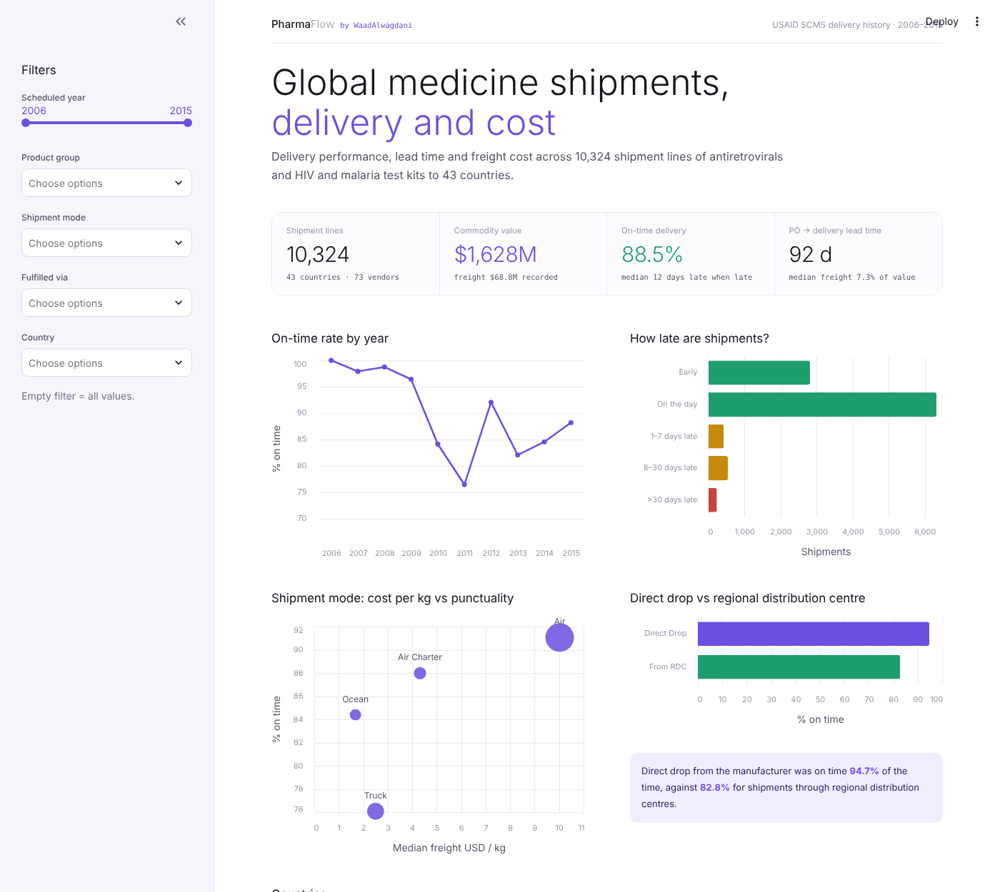

# PharmaFlow by WaadAlwagdani


**Delivery performance and cost in global HIV & malaria medicine supply chains** — an end-to-end data analysis project by **Waad Alwagdani, PharmD** (وعد الوقداني), pharmacist with a focus on pharmaceutical supply chain management.

10,324 real shipment lines from the USAID Supply Chain Management System (SCMS): antiretrovirals and HIV/malaria test kits shipped to 43 countries between 2006 and 2015, worth $1.63 billion.



## Key findings

| # | Finding |
|---|---|
| 1 | **88.5%** of shipment lines arrived on or before the scheduled date. Reliability fell from 96–100% (2006–2009) to **76.5% in 2011**, and never fully recovered. |
| 2 | When late, shipments were late by a **median of 12 days**; 2% were more than a month late. |
| 3 | **Direct drop** from the manufacturer was on time **94.7%** of the time, against **82.8%** through regional distribution centres (RDCs), and with lower freight as a share of value (5.9% vs 9.1%). |
| 4 | **Air freight costs about 6× more per kg than ocean** ($10.0 vs $1.7). Trucks were cheap but the **least punctual** mode (76%). |
| 5 | The first-line ARV **efavirenz/lamivudine/tenofovir fell 44%** in price, from $17.48 to $9.76 per pack (2010–2015). |
| 6 | Among high-volume countries, **Vietnam** was the most reliable (99%); **DR Congo** (75%) and **Mozambique** (82%) the least. |

**Recommendations:** set safety stock from the 90th-percentile delay of each lane rather than the average; review RDC replenishment for the weakest countries; and reserve truck routes for lanes that can absorb a 1–4 week delay.

## What the project covers

| Skill | Where |
|---|---|
| **NumPy** | vectorised features (`np.where`, `np.nan`, binning with `np.inf`) in `cleaning.py` and `metrics.py` |
| **Pandas** | method-chained pipeline with `.pipe`, regex extraction, `groupby`, `pivot_table`, `pd.cut`, quantiles |
| **Data cleaning** | Latin-1 encoding, two date formats mixed with text, numbers stored as text, cross-row references (`See DN-304 (ID#:10589)`), shared freight de-duplicated so totals are not inflated, before/after quality report |
| **Data analysis** | on-time rate, delay distribution, lead time, cost per kg, freight % of value, vendor scorecard, price trend |
| **Matplotlib / Seaborn** | custom theme, annotated line and bar charts, heatmap, log-scale scatter (`viz.py`) |
| **EDA** | [`pharmaflow_analysis.ipynb`](pharmaflow/notebooks/pharmaflow_analysis.ipynb): audit → cleaning → 6 questions → conclusions |
| **Dashboard** | `dashboard/app.py`: Streamlit + Altair, filters by year, product, mode, channel and country; CSV export |
| **Testing** | `tests/test_pipeline.py`: edge cases on a hand-built fixture + checks on the real data, run by GitHub Actions |

## Project structure

```
pharmaflow/                 project folder
pharmaflow/pharmaflow/      analysis package
├── io.py              load raw / cleaned data
├── cleaning.py        cleaning pipeline (each step is a function)
├── metrics.py         KPIs and grouped summaries
└── viz.py             Matplotlib / Seaborn charts
notebooks/             executed EDA notebook
dashboard/app.py       Streamlit dashboard
data/raw/              original USAID export
data/processed/        cleaned table (generated)
reports/figures/       exported charts
tests/                 unit tests
```

## Run it

```bash
pip install -r requirements.txt
cd pharmaflow
streamlit run dashboard/app.py                 # dashboard (Streamlit Cloud entry point: pharmaflow/dashboard/app.py)
jupyter notebook notebooks/pharmaflow_analysis.ipynb
python -m unittest discover -s tests -v         # tests
```

## Data

USAID Supply Chain Management System, *Supply Chain Shipment Pricing Data* (delivery history, version 2015-09-29), published on the USAID Development Data Library. US government work, public domain. The analysis covers shipment lines, not individual patients; no personal data is involved.

## Cleaning decisions

* **Weight references are followed**: a line saying "See DN-304 (ID#:10589)" gets the weight recorded on line 10589.
* **Shared freight is counted once**: referencing lines get no freight of their own, so total freight is not double counted.
* "Freight Included in Commodity Cost" is treated as **0**, not missing.
* "Pre-PQ Process", "Date Not Captured" and "N/A - From RDC" become missing dates; RDC shipments therefore have no PO-to-delivery lead time.

---

© 2026 Waad Alwagdani, PharmD (WaadAlwagdani) · waadnalwagdani@gmail.com. All rights reserved. See [LICENSE](LICENSE).
